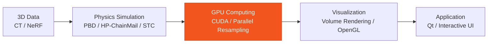

  

  
  
  
  

## About

**Computer graphics · Physics-based simulation · GPU computing**

C/C++와 CUDA를 기반으로 물리 시뮬레이션과 볼륨 렌더링을 연구해 온 그래픽스 개발자입니다. 3D 데이터 처리, GPU 병렬 연산, 렌더링과 Qt GUI를 하나의 시스템으로 연결합니다.

M.S. in Computer Engineering · Hansung University · 2026

## Graphics & Simulation Toolkit

| Area | Technologies & implementation |
| :--- | :--- |
| **Core languages** |      시뮬레이션 엔진, GPU 커널, 병렬 자료구조 |
| **Physics simulation** |      거리·부피·이면각 제약, 피부 인장 제약, 활성 블록 기반 보정 |
| **GPU computing** |      제약 그룹 병렬 계산, RGBA 샘플링, 볼륨 리샘플링 |
| **3D rendering** |       CT 볼륨 시각화, 셰이더, 멀티뷰 및 카메라 투영 |
| **3D data integration** |      NeRF 볼륨과 물리 격자 연결 |
| **Application development** |        GUI 및 렌더링 연동, 이벤트 기반 응용 개발 |
| **Development tools** |    |

## From Data to Visualization

주요 연구와 구현 경험을 연결한 개념도이며 단일 프로젝트의 정확한 실행 순서는 아닙니다.

## Selected Research & Projects

<table>
<tr>
<td width="50%" valign="top">

<h3>01 / STC</h3>
<b>Skin Tension Constraint</b> 
삼각형 면적 기반 피부 인장 제약 설계 및 CUDA PBD 통합.  
<b>+3.23–7.66%</b> 병렬 리샘플링 시간 증가율 
2025년 게재 논문 · 3개 해상도 비교  
<a href="https://doi.org/10.15701/kcgs.2025.31.4.21">Publication ↗</a>
 <a href="https://github.com/soz1p/STC-Showcase">Research Overview ↗</a>
</td>
<td width="50%" valign="top">

<h3>02 / VDR</h3>
<b>Hybrid Volume Deformation &amp; Rendering</b> 
HP-ChainMail warm-start 및 활성 블록 기반 PBD 제한 보정.  
<b>10.77× / 7.96×</b> PBD 보정 반복 평균 시간 기준 속도 향상 
2026 석사학위논문 · Small / Medium · 동일 warm-start  
<a href="https://github.com/soz1p/VDR-Showcase">Research overview ↗</a>
</td>
</tr>
<tr>
<td valign="top">

<h3>03 / NeuralDynaRender</h3>
<b>NeRF × PBD × CUDA</b> 
NeRF RGBA 볼륨과 PBD 격자의 결합, float4 샘플링 및 병렬 리샘플링.  
2024 캡스톤 · 4인 팀 · 공저 논문 
<a href="https://www.kci.go.kr/kciportal/landing/article.kci?arti_id=ART003103457">Publication ↗</a>
 <a href="https://github.com/soz1p/NeuralDynaRender-Showcase">Research Overview ↗</a>
</td>
<td valign="top">

<h3>04 / QtGTCG</h3>
<b>OpenGL Multiview Geometry Viewer</b> 
기하 데이터, 카메라 및 투영 행렬, GLSL 렌더링을 Qt 4분할 뷰어로 구현.  
Graphics mathematics · Top / Front / Side / Perspective 
<a href="https://github.com/soz1p/QtGTCG-Showcase">Source Code ↗</a>
</td>
</tr>
</table>

### Application Projects

| Project | Focus |
| :--- | :--- |
| [Edge of Survival](https://github.com/soz1p/Edge-of-Survival-Showcase) | Unity · C# · Photon PUN 2 · 멀티플레이 및 게임 이벤트 |
| [Fire Evacuation](https://github.com/soz1p/Fire-Evacuation-Showcase) | Unity · C# · 3D 대피 시뮬레이션 및 상태 관리 |

공동 연구의 소스코드는 비공개로 유지하며 공개 가능한 연구 결과와 개인 기여를 포트폴리오에서 소개합니다.

## Thesis

[CT 영상 기반 변형 시뮬레이션을 위한 혼합형 프레임워크](https://dspace.hansung.ac.kr/handle/2024.oak/10820) · 전소진 · 한성대학교 석사학위논문 · 2026

## Publications

| Year | Research |
| :---: | :--- |
| **2025** | **STC: A Skin Tension Constraint Model for Position-Based Dynamics**   First author · 한국컴퓨터그래픽스학회 논문지 31(4), 21–31 · [DOI](https://doi.org/10.15701/kcgs.2025.31.4.21) |
| **2024** | **NeRF, PBD 및 병렬 리샘플링을 결합한 실시간 3D 볼륨 변형체 시각화**   Co-author · 한국컴퓨터그래픽스학회 논문지 30(3), 189–198 · [KCI](https://www.kci.go.kr/kciportal/landing/article.kci?arti_id=ART003103457) |
| **2026** | **이방성 피부 장력 제약(ASTC)을 이용한 PBD 기반 방향성 절개 반응**   Co-author · 한국컴퓨터그래픽스학회 학술대회 포스터 |

---

<b>Research · Implementation · Visualization</b> 
<a href="https://soz1p.github.io/jeon-sojin-portfolio/">View full portfolio</a> 
Profile writing and design assisted by ChatGPT.

