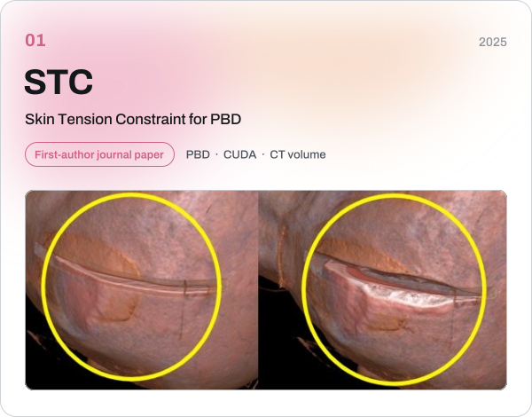
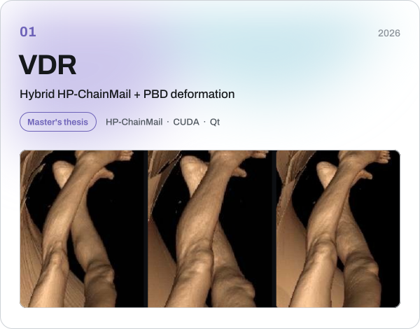
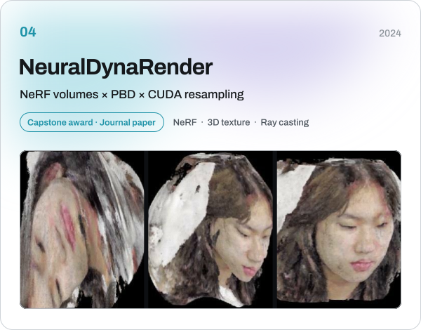
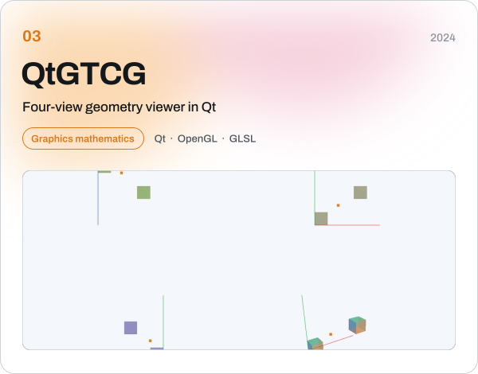
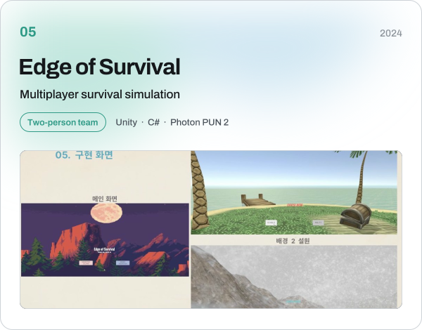
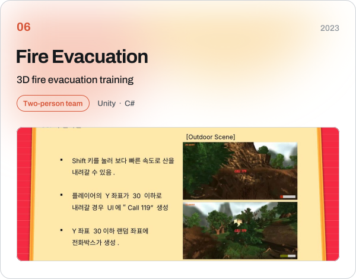
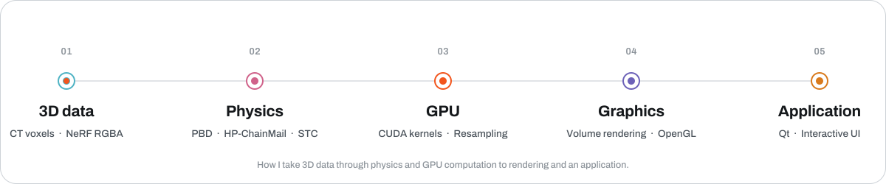

<a href="https://soz1p.github.io/jeon-sojin-portfolio/?lang=en"><picture><source media="(prefers-color-scheme: dark)" srcset="assets/header-dark.svg"></picture></a>

<a href="https://soz1p.github.io/jeon-sojin-portfolio/?lang=en"><picture><source media="(prefers-color-scheme: dark)" srcset="assets/btn-portfolio-en-dark.svg"></picture></a>
<a href="https://soz1p.github.io/jeon-sojin-portfolio/?lang=ko"><picture><source media="(prefers-color-scheme: dark)" srcset="assets/btn-portfolio-ko-dark.svg"></picture></a>
<a href="https://soz1p.github.io/jeon-sojin-portfolio/files/jeon-sojin-cv-en.pdf"><picture><source media="(prefers-color-scheme: dark)" srcset="assets/btn-cv-en-dark.svg"></picture></a>
<a href="https://soz1p.github.io/jeon-sojin-portfolio/files/jeon-sojin-cv.pdf"><picture><source media="(prefers-color-scheme: dark)" srcset="assets/btn-cv-ko-dark.svg"></picture></a>
<a href="mailto:soz1p@naver.com"><picture><source media="(prefers-color-scheme: dark)" srcset="assets/btn-email-dark.svg"></picture></a>

 

<picture><source media="(prefers-color-scheme: dark)" srcset="assets/title-about-dark.svg"></picture>

Graphics engineer with an M.S. in Computer Engineering from Hansung University (2026). I work where **physics-based simulation**, **GPU computing** and **real-time rendering** meet: soft-body deformation with Position-Based Dynamics, CUDA parallel resampling, volume rendering of CT and NeRF data, and the Qt tools that tie them together.

물리 시뮬레이션과 볼륨 렌더링을 연구해 온 그래픽스 개발자입니다. 3D 데이터 처리부터 GPU 병렬 연산, 렌더링, Qt GUI까지 하나의 소프트웨어로 연결합니다.

 

<picture><source media="(prefers-color-scheme: dark)" srcset="assets/title-projects-dark.svg"></picture>

<table>
<tr>
<td width="50%" valign="top">
<a href="https://soz1p.github.io/jeon-sojin-portfolio/?lang=en#p-stc"><picture><source media="(prefers-color-scheme: dark)" srcset="assets/card-stc-dark.svg"></picture></a>

3.23–7.66% extra parallel resampling time for a new surface-tension response, across three CT resolutions.

<a href="https://github.com/soz1p/STC-Showcase">Research overview ↗</a> &nbsp;·&nbsp; <a href="https://soz1p.github.io/jeon-sojin-portfolio/?lang=en#p-stc">Project page ↗</a>

</td>
<td width="50%" valign="top">
<a href="https://soz1p.github.io/jeon-sojin-portfolio/?lang=en#p-vdr"><picture><source media="(prefers-color-scheme: dark)" srcset="assets/card-vdr-dark.svg"></picture></a>

10.77× / 7.96× faster PBD correction (Small / Medium) than full-domain correction under the same warm start.

<a href="https://github.com/soz1p/VDR-Showcase">Research overview ↗</a> &nbsp;·&nbsp; <a href="https://soz1p.github.io/jeon-sojin-portfolio/?lang=en#p-vdr">Project page ↗</a>

</td>
</tr>
<tr>
<td width="50%" valign="top">
<a href="https://soz1p.github.io/jeon-sojin-portfolio/?lang=en#p-ndr"><picture><source media="(prefers-color-scheme: dark)" srcset="assets/card-ndr-dark.svg"></picture></a>

256³ RGBA NeRF volume deformed on a 64³ PBD grid with float4 parallel resampling.

<a href="https://github.com/soz1p/NeuralDynaRender-Showcase">Research overview ↗</a> &nbsp;·&nbsp; <a href="https://soz1p.github.io/jeon-sojin-portfolio/?lang=en#p-ndr">Project page ↗</a>

</td>
<td width="50%" valign="top">
<a href="https://soz1p.github.io/jeon-sojin-portfolio/?lang=en#p-qtgtcg"><picture><source media="(prefers-color-scheme: dark)" srcset="assets/card-qtgtcg-dark.svg"></picture></a>

Top, front, side and perspective views of the same scene, built while studying GTCG.

<a href="https://github.com/soz1p/QtGTCG-Showcase">Source code ↗</a> &nbsp;·&nbsp; <a href="https://soz1p.github.io/jeon-sojin-portfolio/?lang=en#p-qtgtcg">Project page ↗</a>

</td>
</tr>
<tr>
<td width="50%" valign="top">
<a href="https://soz1p.github.io/jeon-sojin-portfolio/?lang=en#p-eos"><picture><source media="(prefers-color-scheme: dark)" srcset="assets/card-eos-dark.svg"></picture></a>

Photon networking, island scenario events, survival UI.

<a href="https://github.com/soz1p/Edge-of-Survival-Showcase">Source code ↗</a> &nbsp;·&nbsp; <a href="https://soz1p.github.io/jeon-sojin-portfolio/?lang=en#p-eos">Project page ↗</a>

</td>
<td width="50%" valign="top">
<a href="https://soz1p.github.io/jeon-sojin-portfolio/?lang=en#p-fire"><picture><source media="(prefers-color-scheme: dark)" srcset="assets/card-fire-dark.svg"></picture></a>

Outdoor terrain, fire spread, emergency call point and player state.

<a href="https://github.com/soz1p/Fire-Evacuation-Showcase">Source code ↗</a> &nbsp;·&nbsp; <a href="https://soz1p.github.io/jeon-sojin-portfolio/?lang=en#p-fire">Project page ↗</a>

</td>
</tr>
</table>

Research overviews share published results and individual contributions; laboratory source code and original research data stay private. Application repositories contain selected implementation code.

  

<picture><source media="(prefers-color-scheme: dark)" srcset="assets/title-pipeline-dark.svg"></picture>

<picture><source media="(prefers-color-scheme: dark)" srcset="assets/pipeline-dark.svg"></picture>

 

<picture><source media="(prefers-color-scheme: dark)" srcset="assets/title-toolkit-dark.svg"></picture>

| Area | Experience |
| :--- | :--- |
| **Physics simulation** | PBD · HP-ChainMail · STC · distance / volume / dihedral constraints · active-block correction |
| **GPU computing** | CUDA kernels · parallel constraint projection · 3D textures · float4 RGBA sampling · parallel resampling |
| **3D graphics** | Volume rendering · ray casting · GLSL · geometry and camera transforms · multiview rendering |
| **Data** | CT voxel volumes · NeRF RGBA volumes · physics-grid integration |
| **Applications** | Qt architecture and modularization · GLFW / ImGui · Unity / C# |

 

<picture><source media="(prefers-color-scheme: dark)" srcset="assets/title-pubs-dark.svg"></picture>

| Year | Publication |
| :---: | :--- |
| **2026** | **Master's thesis** — Hybrid framework for CT-based deformation simulation: HP-ChainMail and PBD active-block restricted correction · [Hansung University repository](https://dspace.hansung.ac.kr/handle/2024.oak/10820) |
| **2026** | **Conference poster, co-author** — PBD-based directional incision response using anisotropic skin tension constraints (ASTC) · Korea Computer Graphics Society |
| **2025** | **Journal article, first author** — STC: A Skin Tension Constraint Model for Position-Based Dynamics · KCGS 31(4), 21–31 · [KCI](https://www.kci.go.kr/kciportal/landing/article.kci?arti_id=ART003238324) |
| **2024** | **Journal article, co-author** — Real-Time 3D Volume Deformation and Visualization by Integrating NeRF, PBD, and Parallel Resampling · KCGS 30(3), 189–198 · [KCI](https://www.kci.go.kr/kciportal/landing/article.kci?arti_id=ART003103457) |

 

<a href="https://soz1p.github.io/jeon-sojin-portfolio/?lang=en">Interactive portfolio</a> &nbsp;·&nbsp; <a href="https://soz1p.github.io/jeon-sojin-portfolio/?lang=ko">한국어 포트폴리오</a> &nbsp;·&nbsp; <a href="mailto:soz1p@naver.com">soz1p@naver.com</a> 
Profile writing and design assisted by Claude and ChatGPT.

