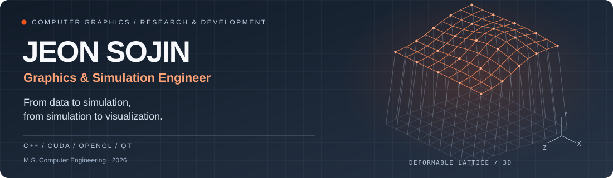
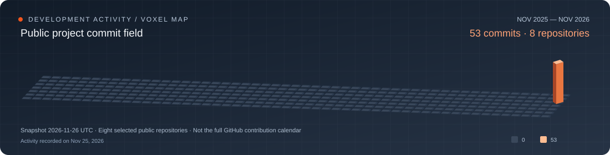
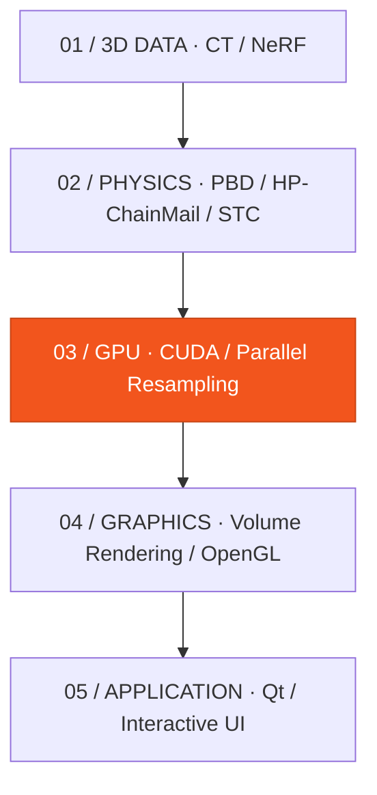

  

  
  
  
  
  

## 01 / About

**Computer Graphics · Physics-based Simulation · GPU Computing**

Graphics engineer with an M.S. in Computer Engineering from Hansung University (2026). My research and implementation experience spans physics-based soft-body deformation, CUDA parallel computation, volume rendering and interactive Qt applications.

물리 시뮬레이션과 볼륨 렌더링을 연구해 온 그래픽스 개발자입니다. 데이터 처리부터 GPU 연산, 렌더링, GUI까지 하나의 소프트웨어로 연결합니다.

  

## 02 / Selected Projects

<table>
<tr>
<td width="50%" valign="top">

01 / 2025 · First-author journal paper
<h3><a href="https://github.com/soz1p/STC-Showcase">STC</a></h3>
<b>Skin Tension Constraint</b> 
Triangle-area constraints for skin tension near incisions.  
<code>PBD · CUDA · CT Volume</code> 
 3.23–7.66% additional parallel resampling time across three resolutions. 
 <a href="https://github.com/soz1p/STC-Showcase">Research Overview ↗</a> · <a href="https://soz1p.github.io/jeon-sojin-portfolio/?lang=en#p-stc">Project details ↗</a>
</td>
<td width="50%" valign="top">

02 / 2026 · Master's thesis
<h3><a href="https://github.com/soz1p/VDR-Showcase">VDR</a></h3>
<b>Hybrid Volume Deformation &amp; Rendering</b> 
HP-ChainMail warm-start and active-block restricted PBD correction.  
<code>HP-ChainMail · CUDA · Qt</code> 
 10.77× / 7.96× speedup per PBD correction iteration for Small / Medium vs. global correction, under identical warm-start. 
 <a href="https://github.com/soz1p/VDR-Showcase">Research Overview ↗</a> · <a href="https://soz1p.github.io/jeon-sojin-portfolio/?lang=en#p-vdr">Project details ↗</a>
</td>
</tr>
<tr>
<td width="50%" valign="top">

03 / 2024 · Four-person capstone &amp; journal paper
<h3><a href="https://github.com/soz1p/NeuralDynaRender-Showcase">NeuralDynaRender</a></h3>
<b>NeRF × PBD × CUDA</b> 
Integrated RGBA volumes with PBD and implemented CUDA float4 parallel resampling.  
<code>NeRF · 3D Texture · Ray Casting</code> 
 256³ RGBA volume · 64³ physics grid in the published study. 
 <a href="https://github.com/soz1p/NeuralDynaRender-Showcase">Research Overview ↗</a> · <a href="https://soz1p.github.io/jeon-sojin-portfolio/?lang=en#p-ndr">Project details ↗</a>
</td>
<td width="50%" valign="top">

04 / Graphics mathematics study
<h3><a href="https://github.com/soz1p/QtGTCG-Showcase">QtGTCG</a></h3>
<b>Multiview Geometry Viewer</b> 
Four simultaneous camera views implementing geometry and projection concepts.  
<code>Qt · OpenGL · GLSL</code> 
 Top · Front · Side · Perspective 
 <a href="https://github.com/soz1p/QtGTCG-Showcase">Source Code ↗</a> · <a href="https://soz1p.github.io/jeon-sojin-portfolio/?lang=en#p-qtgtcg">Project details ↗</a>
</td>
</tr>
<tr>
<td width="50%" valign="top">

05 / 2024 · Two-person team
<h3><a href="https://github.com/soz1p/Edge-of-Survival-Showcase">Edge of Survival</a></h3>
<b>Multiplayer Survival Simulation</b> 
Network integration, game events, survival mechanics and UI.  
<code>Unity · C# · Photon PUN 2</code> 

 <a href="https://github.com/soz1p/Edge-of-Survival-Showcase">Source Code ↗</a> · <a href="https://soz1p.github.io/jeon-sojin-portfolio/?lang=en#p-eos">Project details ↗</a>
</td>
<td width="50%" valign="top">

06 / 2023 · Two-person team
<h3><a href="https://github.com/soz1p/Fire-Evacuation-Showcase">Fire Evacuation</a></h3>
<b>3D Evacuation Simulator</b> 
Outdoor terrain, fire spread, emergency reporting and player state.  
<code>Unity · C#</code> 

 <a href="https://github.com/soz1p/Fire-Evacuation-Showcase">Source Code ↗</a> · <a href="https://soz1p.github.io/jeon-sojin-portfolio/?lang=en#p-fire">Project details ↗</a>
</td>
</tr>
</table>

Research showcases present shareable results and individual contributions; laboratory source code and original research data remain private. Application repositories contain selected implementation code.

## 03 / Graphics & Simulation Toolkit

| Domain | Implementation experience |
| :--- | :--- |
| **Physics simulation** | PBD, HP-ChainMail, STC, distance / volume / dihedral constraints, active-block correction |
| **GPU computing** | CUDA kernels, parallel constraint projection, 3D textures, float4 RGBA sampling, parallel resampling |
| **3D graphics** | Volume rendering, ray casting, GLSL shaders, geometry, camera transforms, multiview rendering |
| **Data integration** | CT voxel data, NeRF RGBA volumes, physics-grid integration |
| **Applications** | Qt architecture and modularization, GLFW / ImGui, Unity / C# |
| **Development** | C/C++, CMake, Visual Studio, Git / GitHub |

## 04 / From Data to Visualization

Conceptual map of research and implementation experience, not the execution order of a single project.

## 05 / Research & Publications

| Year | Publication |
| :---: | :--- |
| **2026** | **Master's thesis** · Hybrid framework for CT-based deformation simulation: HP-ChainMail and PBD active-block restricted solving · [University repository](https://dspace.hansung.ac.kr/handle/2024.oak/10820) |
| **2026** | **Conference poster · Co-author** · PBD-based directional incision response using anisotropic skin tension constraints (ASTC) · Korea Computer Graphics Society |
| **2025** | **Journal article · First author** · STC: A Skin Tension Constraint Model for Position-Based Dynamics · KCGS 31(4), 21–31 · [KCI](https://www.kci.go.kr/kciportal/landing/article.kci?arti_id=ART003238324) |
| **2024** | **Journal article · Co-author** · Real-Time 3D Volume Deformation and Visualization by Integrating NeRF, PBD, and Parallel Resampling · KCGS 30(3), 189–198 · [KCI](https://www.kci.go.kr/kciportal/landing/article.kci?arti_id=ART003103457) |

---

<b>RESEARCH · IMPLEMENTATION · VISUALIZATION</b> 
<a href="https://soz1p.github.io/jeon-sojin-portfolio/?lang=en">Interactive portfolio (EN)</a> · <a href="https://soz1p.github.io/jeon-sojin-portfolio/?lang=ko">Portfolio (KO)</a> 
Profile writing and design assisted by ChatGPT.

